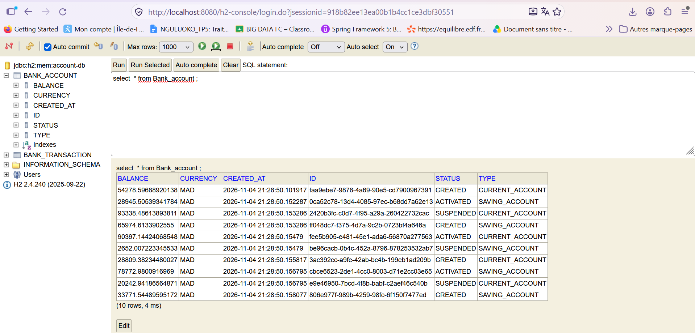

# Atelier Spring Boot : gestion des comptes avec REST, JPA et Spring Data REST

> **Objectif :** construire progressivement une application Spring Boot
> de gestion de comptes, tester sa couche DAO, exposer des API REST,
> documenter les API avec Swagger/OpenAPI, puis découvrir Spring Data
> REST, les projections, les DTOs et les mappers.

## Sommaire

1.  [Créer le projet Spring Boot](#1-créer-le-projet-spring-boot)
2.  [Créer l'entité JPA `Compte`](#2-créer-lentité-jpa-compte)
3.  [Créer `CompteRepository`](#3-créer-compterepository)
4.  [Tester la couche DAO](#4-tester-la-couche-dao)
5.  [Créer le service REST de gestion des
    comptes](#5-créer-le-service-rest-de-gestion-des-comptes)
6.  [Tester le microservice avec
    Postman](#6-tester-le-microservice-avec-postman)
7.  [Générer et tester la documentation
    Swagger](#7-générer-et-tester-la-documentation-swagger)
8.  [Exposer une API avec Spring Data REST et des
    projections](#8-exposer-une-api-avec-spring-data-rest-et-des-projections)
9.  [Créer les DTOs et les mappers](#9-créer-les-dtos-et-les-mappers)
10. [Créer la couche Service métier et finaliser le
    microservice](#10-créer-la-couche-service-métier-et-finaliser-le-microservice)

------------------------------------------------------------------------

## 1. Créer le projet Spring Boot

### Travail à faire

Créer un projet Spring Boot avec les dépendances suivantes :

-   **Spring Web** : création des contrôleurs et des API REST.
-   **Spring Data JPA** : accès aux données avec JPA et Hibernate.
-   **H2 Database** : base de données en mémoire pour les tests et les
    démonstrations.
-   **Lombok** : réduction du code répétitif (getters, setters,
    constructeurs, etc.).
-   **Spring Boot Test** : tests unitaires et tests d'intégration.


### Dépendances Maven

 `pom.xml` :

``` xml
<?xml version="1.0" encoding="UTF-8"?>
<project xmlns="http://maven.apache.org/POM/4.0.0" xmlns:xsi="http://www.w3.org/2001/XMLSchema-instance"
         xsi:schemaLocation="http://maven.apache.org/POM/4.0.0 https://maven.apache.org/xsd/maven-4.0.0.xsd">
    <modelVersion>4.0.0</modelVersion>
    <parent>
        <groupId>org.springframework.boot</groupId>
        <artifactId>spring-boot-starter-parent</artifactId>
        <version>4.1.0</version>
        <relativePath/> <!-- lookup parent from repository -->
    </parent>
    <groupId>org.ngueoko</groupId>
    <artifactId>bank-account-service</artifactId>
    <version>0.0.1-SNAPSHOT</version>
    <name>bank-account-service</name>
    <description>bank-account-service</description>
    <url/>
    <licenses>
        <license/>
    </licenses>
    <developers>
        <developer/>
    </developers>
    <scm>
        <connection/>
        <developerConnection/>
        <tag/>
        <url/>
    </scm>
    <properties>
        <java.version>17</java.version>
        <lombok.version>1.18.42</lombok.version>
    </properties>
    <dependencies>
        <dependency>
            <groupId>org.springframework.boot</groupId>
            <artifactId>spring-boot-h2console</artifactId>
        </dependency>
        <dependency>
            <groupId>org.springframework.boot</groupId>
            <artifactId>spring-boot-starter-data-jpa</artifactId>
        </dependency>
        <dependency>
            <groupId>org.springframework.boot</groupId>
            <artifactId>spring-boot-starter-data-rest</artifactId>
        </dependency>
        <dependency>
            <groupId>org.springframework.boot</groupId>
            <artifactId>spring-boot-starter-graphql</artifactId>
        </dependency>
        <dependency>
            <groupId>org.springframework.boot</groupId>
            <artifactId>spring-boot-starter-webmvc</artifactId>
        </dependency>

        <dependency>
            <groupId>com.h2database</groupId>
            <artifactId>h2</artifactId>
            <scope>runtime</scope>
        </dependency>
        <dependency>
            <groupId>org.projectlombok</groupId>
            <artifactId>lombok</artifactId>
            <optional>true</optional>
        </dependency>
        <dependency>
            <groupId>org.springframework.boot</groupId>
            <artifactId>spring-boot-starter-data-jpa-test</artifactId>
            <scope>test</scope>
        </dependency>
        <dependency>
            <groupId>org.springframework.boot</groupId>
            <artifactId>spring-boot-starter-graphql-test</artifactId>
            <scope>test</scope>
        </dependency>
        <dependency>
            <groupId>org.springframework.boot</groupId>
            <artifactId>spring-boot-starter-webmvc-test</artifactId>
            <scope>test</scope>
        </dependency>
        <dependency>
            <groupId>org.springdoc</groupId>
            <artifactId>springdoc-openapi-starter-webmvc-ui</artifactId>
            <version>3.2.0</version>
        </dependency>
        <dependency>
            <groupId>org.mapstruct</groupId>
            <artifactId>mapstruct</artifactId>
            <version>${org.mapstruct.version}</version>
        </dependency>
    </dependencies>

    <build>
        <plugins>
            <plugin>
                <groupId>org.springframework.boot</groupId>
                <artifactId>spring-boot-maven-plugin</artifactId>
            </plugin>
            <plugin>
                <groupId>org.apache.maven.plugins</groupId>
                <artifactId>maven-compiler-plugin</artifactId>
                <executions>
                    <execution>
                        <id>default-compile</id>
                        <phase>compile</phase>
                        <goals>
                            <goal>compile</goal>
                        </goals>
                        <configuration>
                            <annotationProcessorPaths>
                                <path>
                                    <groupId>org.projectlombok</groupId>
                                    <artifactId>lombok</artifactId>
                                </path>
                                <path>
                                    <groupId>org.mapstruct</groupId>
                                    <artifactId>mapstruct-processor</artifactId>
                                    <version>${org.mapstruct.version}</version>
                                </path>
                                <path>
                                    <groupId>org.projectlombok</groupId>
                                    <artifactId>lombok-mapstruct-binding</artifactId>
                                    <version>0.2.0</version>
                                </path>
                            </annotationProcessorPaths>
                        </configuration>
                    </execution>
                    <execution>
                        <id>default-testCompile</id>
                        <phase>test-compile</phase>
                        <goals>
                            <goal>testCompile</goal>
                        </goals>
                        <configuration>
                            <annotationProcessorPaths>
                                <path>
                                    <groupId>org.projectlombok</groupId>
                                    <artifactId>lombok</artifactId>
                                </path>
                            </annotationProcessorPaths>
                        </configuration>
                    </execution>
                </executions>
            </plugin>
        </plugins>
    </build>

</project>
```


### Configuration H2

Dans `src/main/resources/application.properties` :

``` properties
spring.application.name=bank-account-service
spring.datasource.url=jdbc:h2:mem:account-db
spring.h2.console.enabled=true
server.port=8080
```

### Vérifications

1.  Démarrer l'application.
2.  Vérifier qu'elle démarre sans erreur.
3.  Ouvrir la console H2 à l'adresse `http://localhost:8080/h2-console`.
4.  Utiliser l'URL JDBC `jdbc:h2:mem:comptesdb`, l'utilisateur `sa` et
    un mot de passe vide.

### Captures d'écran base donnée H2 



------------------------------------------------------------------------

## 2. Créer l'entité JPA `BankAccount`

### Travail à faire

Création de la classe `BankAccount` représentant un compte bancaire. Cette classe
sera persistée dans la base de données grâce à JPA.

### Attributs 

  Attribut         Type Java                  Description
  ---------------- -------------------------- -----------------------
  `id`             `UUID`                     Identifiant du compte
  `balance`        `Double`                   Solde du compte
  `dateCreation`   `LocalDateTime`            Date de création
  `type`           `AccountType`              Type de compte
  `currency`       `String`                   Devise du compte
  `status`         `AccountStatus`            Statut du compte


### Énumération 

``` java
public enum AccountStatus {
    CREATED,
    ACTIVATED,
    SUSPENDED
}

public enum AccountType {
    CURRENT_ACCOUNT,
    SAVING_ACCOUNT
}

public enum TransactionType {
    DEBIT,
    CREDIT
}

```

### Entité `Compte`

``` java
import jakarta.persistence.*;
import lombok.*;
import org.hibernate.annotations.UuidGenerator;
import org.ngueoko.bankaccountservice.enums.AccountStatus;
import org.ngueoko.bankaccountservice.enums.AccountType;

import java.time.LocalDateTime;
import java.util.UUID;


@Builder
@Data
@Table(name ="bank_account")
@AllArgsConstructor
@NoArgsConstructor
@ToString(exclude = "transactions")
@Entity
public class BankAccount {
    @Id
    @UuidGenerator
    private UUID id;

    @Column(nullable = false)
    private Double balance;

    @Column(nullable = false, updatable = false)
    private LocalDateTime createdAt;

    @Column(nullable = false, updatable = false)
    private LocalDateTime updatedAt;

    @Enumerated(EnumType.STRING)
    @Column(nullable = false)
    private AccountType type;

    @Enumerated(EnumType.STRING)
    @Column(nullable = false)
    private AccountStatus status;

    @Column(length = 3)
    private String currency; // ex : "MAD", "EUR"

    @PrePersist
    void onCreate() {
        if (createdAt == null) {
            createdAt = LocalDateTime.now();
        }
        if (updatedAt == null) {
            updatedAt = LocalDateTime.now();
        }
    }
   
}

```

------------------------------------------------------------------------

## 3. Créer `BankAccountRepository`

### Travail à faire

Créer l'interface `CompteRepository` en s'appuyant sur Spring Data JPA.

``` java
import org.ngueoko.bankaccountservice.entities.BankAccount;
import org.ngueoko.bankaccountservice.enums.AccountType;
import org.springframework.data.jpa.repository.JpaRepository;
import org.springframework.data.repository.query.Param;
import org.springframework.data.rest.core.annotation.RepositoryRestResource;
import org.springframework.data.rest.core.annotation.RestResource;


import java.util.List;
import java.util.UUID;

@Repository
public interface BankAccountRepository extends JpaRepository<BankAccount, UUID> {
   
}

```

Cette simple déclaration donne accès à plusieurs opérations standards :

  Méthode            Rôle
  ------------------ ----------------------------------------
  `save(compte)`     Enregistrer ou mettre à jour un compte
  `findById(id)`     Rechercher un compte par identifiant
  `findAll()`        Récupérer tous les comptes
  `deleteById(id)`   Supprimer un compte

### une méthode de recherche dérivée

Spring Data JPA peut générer une requête à partir du nom de la méthode :

``` java
@RepositoryRestResource
public interface BankAccountRepository extends JpaRepository<BankAccount, UUID> {
   @RestResource(path="/bytype")
    List<BankAccount> findByType(@Param("t") AccountType type);
}

```

Cette méthode permet de rechercher les comptes selon leur type.

------------------------------------------------------------------------

## 4. Tester la couche DAO

### Travail à faire

Vérifier que le repository permet bien d'enregistrer, de rechercher, de
modifier et de supprimer des comptes.

### Captures d'écran 


------------------------------------------------------------------------

## 5. Créer le service REST de gestion des comptes

### Travail  fait

Création du contrôleur REST qui expose les opérations de gestion des
comptes.

Dans un premier temps, le contrôleur peut utiliser directement
`CompteRepository` pour comprendre le fonctionnement des annotations
REST. La séparation en couche métier sera réalisée dans la partie 10.

### Endpoints proposés

  Méthode HTTP       URL                   Opération
  -------------- ----------------------- ---------------------
  `GET`          `/api/bankAccounts`        Lister les comptes
  `GET`          `/api/bankAccounts/{id}`   Consulter un compte
  `POST`         `/api/bankAccounts`        Créer un compte
  `PUT`          `/api/bankAccounts/{id}`   Modifier un compte
  `DELETE`       `/api/bankAccounts/{id}`   Supprimer un compte

### Exemple de contrôleur

``` java
import org.springframework.http.HttpStatus;
import org.springframework.web.bind.annotation.*;
import org.springframework.web.server.ResponseStatusException;

import java.util.List;

@RestController
@RequestMapping("/api/comptes")
public class CompteRestController {

    private final CompteRepository compteRepository;

    public CompteRestController(CompteRepository compteRepository) {
        this.compteRepository = compteRepository;
    }

    @GetMapping
    public List<Compte> getComptes() {
        return compteRepository.findAll();
    }

    @GetMapping("/{id}")
    public Compte getCompte(@PathVariable Long id) {
        return compteRepository.findById(id)
                .orElseThrow(() -> new ResponseStatusException(
                        HttpStatus.NOT_FOUND, "Compte introuvable"));
    }

    @PostMapping
    @ResponseStatus(HttpStatus.CREATED)
    public Compte createCompte(@RequestBody Compte compte) {
        compte.setId(null);
        return compteRepository.save(compte);
    }

    @PutMapping("/{id}")
    public Compte updateCompte(
            @PathVariable Long id,
            @RequestBody Compte compte) {

        if (!compteRepository.existsById(id)) {
            throw new ResponseStatusException(
                    HttpStatus.NOT_FOUND, "Compte introuvable");
        }

        compte.setId(id);
        return compteRepository.save(compte);
    }

    @DeleteMapping("/{id}")
    @ResponseStatus(HttpStatus.NO_CONTENT)
    public void deleteCompte(@PathVariable Long id) {
        if (!compteRepository.existsById(id)) {
            throw new ResponseStatusException(
                    HttpStatus.NOT_FOUND, "Compte introuvable");
        }

        compteRepository.deleteById(id);
    }
}
```

### Points à comprendre

-   `@RestController` : indique que la classe expose des ressources
    REST.
-   `@RequestMapping` : définit le chemin de base.
-   `@GetMapping` : expose une opération HTTP GET.
-   `@PostMapping` : expose une opération HTTP POST.
-   `@PutMapping` : expose une opération HTTP PUT.
-   `@DeleteMapping` : expose une opération HTTP DELETE.
-   `@PathVariable` : récupère une valeur présente dans l'URL.
-   `@RequestBody` : convertit le corps JSON en objet Java.

------------------------------------------------------------------------

## 6. Test microservice avec Postman


### Captures d'écran 

1. Liste des comptes


*Image 6.1 --- Postman : récupération de la liste des comptes (GET).*


*Image 6.2 --- Postman : récupération d'un compte par son identifiant.*


*Image 6.3 --- Postman : création d'un compte (POST).*


*Image 6.4 --- H2 : vérification de la nouvelle ligne créée en base.*


*Image 6.5 --- Postman : mise à jour d'un compte (PUT).*


*Image 6.6 --- H2 : état de la table avant la suppression.*


*Image 6.7 --- Postman : suppression d'un compte (DELETE).*


*Image 6.8 --- H2 : vérification après suppression.*

------------------------------------------------------------------------

## 7. Test de la documentation Swagger

### Travail à faire

Ajout Springdoc OpenAPI pour générer automatiquement la documentation
des API REST et disposer d'une interface Swagger UI.

**Utiliser impérativement la dépendance suivante**, à la place de celle
mentionnée dans la vidéo :

``` xml
<dependency>
    <groupId>org.springdoc</groupId>
    <artifactId>springdoc-openapi-starter-webmvc-ui</artifactId>
    <version>3.2.0</version>
</dependency>
```

Cette dépendance est à ajouter dans la section `<dependencies>` du
`pom.xml`.

### Accéder à Swagger UI

Lorsque l'application est démarrée, ouvrir :

``` text
http://localhost:8080/swagger-ui/index.html
```

Le document OpenAPI au format JSON est normalement accessible à
l'adresse :

``` text
http://localhost:8080/v3/api-docs
```

### Tester les API avec Swagger


### Captures d'écran 


*Image 7.1 --- Interface Swagger UI et endpoints documentés.*


*Image 7.2 --- Exécution d'un endpoint GET depuis Swagger UI.*


*Image 7.3 --- Consultation d'un compte par identifiant depuis Swagger
UI.*

------------------------------------------------------------------------

## 8. Exposer une API avec Spring Data REST et des projections

### Travail à faire

Découvrir Spring Data REST, qui permet d'exposer automatiquement des
repositories sous forme de ressources REST, sans écrire un contrôleur
REST pour chaque opération.

### Ajouter la dépendance

``` xml
<dependency>
    <groupId>org.springframework.boot</groupId>
    <artifactId>spring-boot-starter-data-rest</artifactId>
</dependency>
```


### Exposer le repository

Il est possible de personnaliser le chemin de la ressource :

``` java
@RepositoryRestResource
public interface BankAccountRepository extends JpaRepository<BankAccount, UUID> {
   @RestResource(path="/bytype")
    List<BankAccount> findByType(@Param("t") AccountType type);
}
```

L'API Spring Data REST sera alors exposée sous une URL de la forme :

``` text
http://localhost:8080/bankAccounts
```

### Créer une projection

Une projection permet de choisir les propriétés visibles dans une
représentation REST.

 `AccountProjection`.

``` java
import org.ngueoko.bankaccountservice.enums.AccountType;
import org.springframework.data.rest.core.config.Projection;

import java.util.UUID;

@Projection(types= BankAccount.class,name="p1")
public interface AccountProjection {
    UUID getId();
    AccountType getType();
}
```


``` text
http://localhost:8080/bankAccounts?projection=p1
```

### Captures d'écran 


*Image 8.2 --- Réponse HAL de Spring Data REST avec les liens des
ressources.*


*Image 8.3 --- Réponse Spring Data REST utilisant une projection.*


*Image 8.4 --- Consultation des ressources exposées par Spring Data
REST.*

------------------------------------------------------------------------

## 9. Créer les DTOs et les mappers


### Créer `BankAccountRequestDTO`  `BankAccountResponseDTO`

``` java
import lombok.AllArgsConstructor;
import lombok.Builder;
import lombok.Data;
import lombok.NoArgsConstructor;
import org.ngueoko.bankaccountservice.enums.AccountStatus;
import org.ngueoko.bankaccountservice.enums.AccountType;

import java.time.LocalDateTime;
import java.util.UUID;

@NoArgsConstructor
@AllArgsConstructor
@Builder
@Data
public class BankAccountResponseDTO {
    private UUID id;
    private Double balance;
    private LocalDateTime createdAt;
    private LocalDateTime updatedAt;
    private AccountType type;
    private AccountStatus status;
    private String currency;
}

import lombok.AllArgsConstructor;
import lombok.Builder;
import lombok.Data;
import lombok.NoArgsConstructor;
import org.ngueoko.bankaccountservice.enums.AccountStatus;
import org.ngueoko.bankaccountservice.enums.AccountType;

@NoArgsConstructor @AllArgsConstructor @Builder
@Data
public class BankAccountRequestDTO {
    private Double balance;
    private AccountType type;
    private AccountStatus status;
    private String currency;
}

```

### Créer `BankAccountMapper`


``` java
import org.mapstruct.AfterMapping;
import org.mapstruct.Mapper;
import org.mapstruct.MappingTarget;
import org.ngueoko.bankaccountservice.dto.BankAccountRequestDTO;
import org.ngueoko.bankaccountservice.dto.BankAccountResponseDTO;
import org.ngueoko.bankaccountservice.entities.BankAccount;

import java.time.LocalDateTime;
import java.util.List;

@Mapper(componentModel = "spring")
public interface BankAccountMapper  {
     BankAccount sourceToDestination(BankAccountRequestDTO bankAccountRequestDTO);
     BankAccountResponseDTO destinationToSource(BankAccount bankAccount);
     List<BankAccountResponseDTO>  fromBankAccountList(List<BankAccount> bankAccounts);

     //Test de sur cette Methode
     @AfterMapping
    default void setUpdatedDate(@MappingTarget BankAccount bankAccount){
         bankAccount.setUpdatedAt(LocalDateTime.now());
     }
    //Test de sur cette Methode
    @AfterMapping
    default void setcreatedDate(@MappingTarget BankAccount bankAccount){
        bankAccount.setCreatedAt(LocalDateTime.now());
    }
}

```

### Variante :  MapStruct

MapStruct va générer automatiquement le code de mapping à la
compilation. Il nécessite une configuration supplémentaire du processeur
d'annotations dans Maven, notamment comme Lombok est également utilisé.

Pour ce travail, commencer par un mapper manuel permet de mieux
comprendre le rôle de cette couche.
```
 <dependency>
            <groupId>org.mapstruct</groupId>
            <artifactId>mapstruct</artifactId>
            <version>${org.mapstruct.version}</version>
 </dependency>
 
 <plugin>
             <groupId>org.apache.maven.plugins</groupId>
                <artifactId>maven-compiler-plugin</artifactId>
                <executions>
                    <execution>
                        <id>default-compile</id>
                        <phase>compile</phase>
                        <goals>
                            <goal>compile</goal>
                        </goals>
                        <configuration>
                            <annotationProcessorPaths>
                                <path>
                                    <groupId>org.projectlombok</groupId>
                                    <artifactId>lombok</artifactId>
                                </path>
                                <path>
                                    <groupId>org.mapstruct</groupId>
                                    <artifactId>mapstruct-processor</artifactId>
                                    <version>${org.mapstruct.version}</version>
                                </path>
                                <path>
                                    <groupId>org.projectlombok</groupId>
                                    <artifactId>lombok-mapstruct-binding</artifactId>
                                    <version>0.2.0</version>
                                </path>
                            </annotationProcessorPaths>
                        </configuration>
                    </execution>
                    <execution>
                        <id>default-testCompile</id>
                        <phase>test-compile</phase>
                        <goals>
                            <goal>testCompile</goal>
                        </goals>
                        <configuration>
                            <annotationProcessorPaths>
                                <path>
                                    <groupId>org.projectlombok</groupId>
                                    <artifactId>lombok</artifactId>
                                </path>
                            </annotationProcessorPaths>
                        </configuration>
                    </execution>
                </executions>
            </plugin>
 
      
```
------------------------------------------------------------------------

## 10. Créer la couche Service métier et finaliser le microservice


### Architecture cible

``` text
src/main/java/org/ngueoko/bankaccountservice/
├── BankAccountServiceApplication.java
├── web/
│   └── AccountRestController.java
├── service/
│   ├── IAccountService.java
│   └── AccountServiceImpl.java
├── repositories/
│   └── BankAccountRepository.java
├── entities/
│   ├── BankAccount.java
│   └── TypeCompte.java
├── dto/
│   └── CompteDTO.java
│   
└── mappers/
    └── BankAccountMapper.java
```

### l'interface `IAccountService`

``` java
import org.ngueoko.bankaccountservice.dto.BankAccountRequestDTO;
import org.ngueoko.bankaccountservice.dto.BankAccountResponseDTO;

import java.util.List;
import java.util.UUID;

public interface IAccountService {
    List<BankAccountResponseDTO> bankAccounts();
    BankAccountResponseDTO bankAccount(UUID id);
    BankAccountResponseDTO addAccount(BankAccountRequestDTO account);
    BankAccountResponseDTO update(UUID id, BankAccountRequestDTO bankAccountRequestDTO);
    void delete(UUID id);
}

```

### Implémentation `AccountServiceImpl`

``` java
import lombok.AllArgsConstructor;
import org.ngueoko.bankaccountservice.dto.BankAccountRequestDTO;
import org.ngueoko.bankaccountservice.dto.BankAccountResponseDTO;
import org.ngueoko.bankaccountservice.entities.BankAccount;
import org.ngueoko.bankaccountservice.mappers.BankAccountMapper;
import org.ngueoko.bankaccountservice.repositories.BankAccountRepository;
import org.springframework.stereotype.Service;
import org.springframework.transaction.annotation.Transactional;

import java.util.List;
import java.util.UUID;


@Transactional
@AllArgsConstructor
@Service
public class AccountServiceImpl implements IAccountService{
    private final BankAccountRepository bankAccountRepository;
    private final BankAccountMapper bankAccountsMapper;


    @Override
    public List<BankAccountResponseDTO> bankAccounts() {
        return bankAccountsMapper.fromBankAccountList(bankAccountRepository.findAll());
    }

    @Override
    public BankAccountResponseDTO bankAccount(UUID id) {
       BankAccount bankAccount = bankAccountRepository.findById(id).orElseThrow(
                ()-> new RuntimeException("Bank account with id " + id + " not found")
        );
        return bankAccountsMapper.destinationToSource(bankAccount);
    }

    @Override
    public BankAccountResponseDTO addAccount(BankAccountRequestDTO accountRequestDTO){
        return  bankAccountsMapper.destinationToSource(bankAccountRepository.save(
                bankAccountsMapper.sourceToDestination(accountRequestDTO)));
    }

    @Override
    public BankAccountResponseDTO update(UUID id, BankAccountRequestDTO bankAccountRequestDTO) {
        BankAccount account = bankAccountRepository.findById(id).orElseThrow(
                () -> new RuntimeException("Bank account with id " + id + " not found"));
        BankAccount accountToSave = bankAccountsMapper.sourceToDestination(bankAccountRequestDTO);
        accountToSave.setId(account.getId());
        accountToSave.setCreatedAt(account.getCreatedAt());
        return bankAccountsMapper.destinationToSource(bankAccountRepository.save(accountToSave));
    }

    @Override
    public void delete(UUID id) {
        bankAccountRepository.deleteById(id);
    }
}

```

### le contrôleur REST


``` java
import lombok.AllArgsConstructor;
import org.ngueoko.bankaccountservice.dto.BankAccountRequestDTO;
import org.ngueoko.bankaccountservice.dto.BankAccountResponseDTO;
import org.ngueoko.bankaccountservice.service.IAccountService;
import org.springframework.web.bind.annotation.*;


import java.util.List;
import java.util.UUID;

@AllArgsConstructor
@RestController
public class AccountRestController {

    private final IAccountService iAccountService;

    @GetMapping("/bankAccounts")
    public List<BankAccountResponseDTO> bankAccounts() {
        return iAccountService.bankAccounts();
    }

    @GetMapping("/bankAccounts/{id}")
    public  BankAccountResponseDTO bankAccount(@PathVariable UUID id) {
        return iAccountService.bankAccount(id);
    }

    @PostMapping("/bankAccounts")
    public BankAccountResponseDTO save(@RequestBody BankAccountRequestDTO bankAccountRequestDTO) {
        return iAccountService.addAccount(bankAccountRequestDTO);
    }

    @PutMapping("/bankAccounts/{id}")
    public BankAccountResponseDTO update(@PathVariable UUID id, @RequestBody  BankAccountRequestDTO bankAccount) {
        return iAccountService.update(id,bankAccount);
    }

    @DeleteMapping("/bankAccounts/{id}")
    public  void delete(@PathVariable UUID id) {
        iAccountService.delete(id);
    }

}

```
------------------------------------------------------------------------

